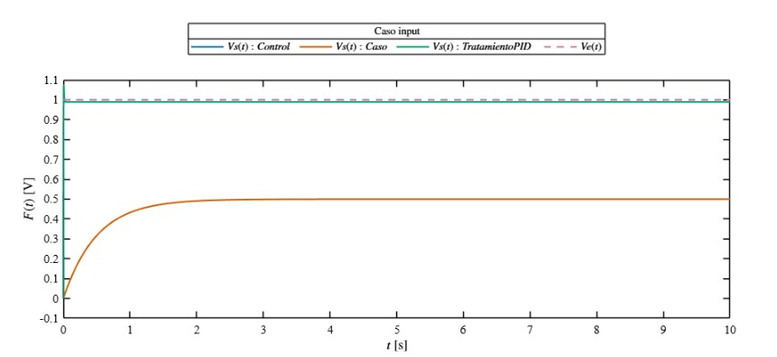

[](https://matlab.mathworks.com/open/github/v1?repo=l23212181-creator/MSFP4)

# Práctica 4 — Modelado y control del sistema endócrino

Repositorio académico de **Modelado de Sistemas Fisiológicos**, correspondiente a **Ingeniería Biomédica** del Tecnológico Nacional de México / Instituto Tecnológico de Tijuana. La práctica aborda la representación simplificada del **sistema endócrino mediante una analogía eléctrica RLC**, la formulación de su modelo matemático, la obtención de funciones de transferencia y el análisis de estabilidad. Se comparan dos condiciones de operación, denominadas **control** y **caso**, y se incorpora un controlador **PID** para aproximar la respuesta de la condición alterada a la respuesta de referencia.

La condición de control utiliza $R_1=1\,\mathrm{k}\Omega$, $L=100\,\mathrm{mH}$, $C=1\,\mu\mathrm{F}$ y $R_2=100\,\mathrm{k}\Omega$. En el caso se conserva $R_1$ y $L$, mientras que $C$ cambia a $1000\,\mu\mathrm{F}$ y $R_2$ a $1\,\mathrm{k}\Omega$. La respuesta de control sirve como referencia para evaluar la respuesta del caso y el tratamiento PID. Las simulaciones se reproducen mediante MATLAB/Simulink y Python, y se complementan con una captura experimental del osciloscopio.

**Docente:** Dr. Paul Antonio Valle Trujillo  
**Correo:** [paul.valle@tectijuana.edu.mx](mailto:paul.valle@tectijuana.edu.mx)  
**Departamento:** Ingeniería Eléctrica y Electrónica  
**Institución:** Tecnológico Nacional de México / Instituto Tecnológico de Tijuana  
**Asignatura:** Modelado de Sistemas Fisiológicos  
**Programa:** Ingeniería Biomédica  
**Estudiante:** Bautista Paz Jesus Geovanny · 23212181 · [l23212181@tectijuana.edu.mx](mailto:l23212181@tectijuana.edu.mx)


**Sede:** Blvd. Alberto Limón Padilla s/n, Tijuana, C. P. 22454, B. C., México.

---

<a id="contenido"></a>
## Contenido

1. [Resumen](#resumen)
2. [Competencia y objetivos](#objetivos)
3. [Relación con el temario](#temario)
4. [Modelo físico y analogía eléctrica](#analogia)
5. [Formulación matemática](#modelo)
6. [Análisis temporal y de estabilidad](#analisis)
7. [Señales de entrada y condiciones de simulación](#senales)
8. [Implementación en MATLAB y Simulink](#matlab)
9. [Control en lazo cerrado y sintonización PID](#pid)
10. [Reproducción en Python](#python)
11. [Controlador analógico y laboratorio](#laboratorio)
12. [Resultados y verificación cruzada](#resultados)
13. [Flujo de trabajo](#flujo)
14. [Actividades del estudiante](#actividades)
15. [Estructura del repositorio](#estructura)
16. [Requisitos](#requisitos)
17. [Reproducibilidad y entregables](#reproducibilidad)
18. [Referencias](#referencias)

---

<a id="resumen"></a>
## Resumen

Se desarrolla un modelo eléctrico equivalente de segundo orden para representar de manera simplificada la dinámica del sistema endócrino. El circuito considera una fuente de entrada, dos resistencias, un capacitor y un inductor para describir, mediante una analogía fenomenológica, el estímulo fisiológico, el transporte, el almacenamiento y la respuesta del órgano diana. Se comparan las respuestas de las condiciones control y caso ante un escalón unitario, utilizando las funciones de transferencia para determinar la ganancia final, el error en estado estacionario y la estabilidad de cada planta.

El desarrollo incluye la implementación del circuito equivalente en MATLAB/Simulink y la reproducción numérica en Python. Finalmente, se incorpora un controlador PID para aproximar la respuesta del caso a la respuesta de control. Los resultados se documentan mediante la gráfica comparativa, la captura de PID Tuner, la evidencia del osciloscopio y el diagrama biológico elaborado en BioRender.

**Palabras clave:** sistema endócrino; modelado fisiológico; analogía eléctrica; circuito RLC; función de transferencia; estabilidad; error en estado estacionario; controlador PID; MATLAB; Simulink; Python; osciloscopio.

[Volver al contenido](#contenido)

---

<a id="objetivos"></a>
## Competencia y objetivos

### Competencia a desarrollar

Aplicar el modelado matemático y las analogías eléctricas para representar la dinámica simplificada de un sistema fisiológico, analizar su comportamiento temporal y evaluar una estrategia de control mediante herramientas de simulación.

### Objetivo general

Formular y analizar un circuito eléctrico equivalente de segundo orden que represente la dinámica simplificada del sistema endócrino, comparar las condiciones control y caso y evaluar un controlador PID que reduzca la diferencia entre sus respuestas.

### Objetivos específicos

- Identificar la correspondencia entre los procesos fisiológicos considerados y los elementos del circuito equivalente.
- Formular las ecuaciones del circuito mediante las leyes de Kirchhoff.
- Obtener las funciones de transferencia para las condiciones control y caso.
- Calcular el error en estado estacionario y analizar la estabilidad mediante los polos.
- Simular las respuestas del sistema mediante MATLAB/Simulink y Python.
- Diseñar y evaluar un controlador PID para aproximar la respuesta del caso a la respuesta de referencia.
- Comparar los resultados computacionales con la evidencia experimental disponible.

[Volver al contenido](#contenido)

---

<a id="temario"></a>
## Relación con el temario

La práctica integra los contenidos de modelado de sistemas fisiológicos, analogías eléctricas, formulación de ecuaciones integro-diferenciales, transformada de Laplace, análisis de sistemas de segundo orden y control clásico.

| Área | Contenido aplicado |
|---|---|
| Modelado fisiológico | Representación simplificada de la dinámica del sistema endócrino |
| Analogías eléctricas | Representación del transporte, almacenamiento y respuesta mediante R, C y L |
| Leyes de Kirchhoff | Formulación de las relaciones del circuito |
| Transformada de Laplace | Obtención de las funciones de transferencia |
| Sistemas de segundo orden | Análisis de polos, estabilidad y respuesta temporal |
| Control clásico | Diseño y sintonización de un controlador PID |
| Simulación y experimentación | Comparación de MATLAB/Simulink, Python y osciloscopio |

[Volver al contenido](#contenido)

---

<a id="analogia"></a>
## Modelo físico y analogía eléctrica

El modelo representa el estímulo fisiológico mediante una fuente de voltaje $V_e(t)$. La resistencia $R_1$ representa la oposición efectiva asociada al transporte hormonal. El capacitor $C$, conectado entre el nodo de salida y la referencia, representa la capacidad de almacenamiento temporal de la señal. La rama formada por el inductor $L$ y la resistencia $R_2$, conectados en serie, representa la dinámica retardada y la oposición asociada con la respuesta, utilización o eliminación de la señal en el órgano diana.

La salida $V_s(t)$ se mide en el nodo posterior a $R_1$, común al capacitor y a la rama $L-R_2$. El flujo de entrada se representa mediante $F_e(t)$, mientras que el flujo de salida se representa mediante $F_s(t)$. La analogía es fenomenológica: reproduce propiedades dinámicas como almacenamiento, disipación, retardo e inercia, sin establecer una equivalencia directa entre los valores eléctricos y parámetros hormonales medidos.

### Diagrama biológico

El diagrama relaciona el estímulo fisiológico, la glándula endócrina, el transporte hormonal, el almacenamiento y la respuesta del órgano diana con los elementos del circuito equivalente. También presenta la comparación entre la condición de control y la condición alterada.


### Parámetros utilizados en las simulaciones

| Parámetro | Control | Caso |
|---|---:|---:|
| $R_1$ | $1\,\mathrm{k}\Omega$ | $1\,\mathrm{k}\Omega$ |
| $L$ | $100\,\mathrm{mH}$ | $100\,\mathrm{mH}$ |
| $C$ | $1\,\mu\mathrm{F}$ | $1000\,\mu\mathrm{F}$ |
| $R_2$ | $100\,\mathrm{k}\Omega$ | $1\,\mathrm{k}\Omega$ |

La condición control se utiliza como referencia. En el caso se incrementa la capacitancia y se reduce $R_2$, modificando la dinámica y el valor final de la respuesta.

[Volver al contenido](#contenido)

---

<a id="modelo"></a>
## Formulación matemática

### 1. Relaciones del circuito equivalente

A partir de las leyes de Kirchhoff, las relaciones del circuito equivalente se expresan como:

$$
V_e(t)=R_1F_e(t)+\frac{1}{C}\int [F_e(t)-F_s(t)]\,dt
$$

$$
\frac{1}{C}\int [F_e(t)-F_s(t)]\,dt
=L\frac{dF_s(t)}{dt}+R_2F_s(t)
$$

La salida se expresa mediante la rama inductiva-resistiva:

$$
V_s(t)=L\frac{dF_s(t)}{dt}+R_2F_s(t)
$$

El desarrollo manuscrito completo se incluye en Análisis matemático de la Práctica 4.

### 2. Función de transferencia

Aplicando la transformada de Laplace con condiciones iniciales nulas, se obtiene:

$$
G(s)=\frac{V_s(s)}{V_e(s)}
=\frac{Ls+R_2}
{R_1LCs^2+(L+R_1R_2C)s+(R_1+R_2)}
$$

Para la condición control, con $R_1=1\,\mathrm{k}\Omega$, $L=0.1\,\mathrm{H}$, $C=1\,\mu\mathrm{F}$ y $R_2=100\,\mathrm{k}\Omega$:

$$
G_{\mathrm{control}}(s)=
\frac{0.1s+100000}
{0.0001s^2+100.1s+101000}
$$

Para la condición caso, con $R_1=1\,\mathrm{k}\Omega$, $L=0.1\,\mathrm{H}$, $C=1000\,\mu\mathrm{F}$ y $R_2=1\,\mathrm{k}\Omega$:

$$
G_{\mathrm{caso}}(s)=
\frac{0.1s+1000}
{0.1s^2+1000.1s+2000}
$$

Estas funciones corresponden a las expresiones implementadas en Python mediante `control.tf`.

### 3. Representación dinámica

El modelo presenta dos elementos de almacenamiento de energía: el capacitor y el inductor. Por ello, la función de transferencia obtenida es de segundo orden. Las expresiones anteriores se utilizan para calcular las respuestas de las condiciones control y caso.

[Volver al contenido](#contenido)

---

<a id="analisis"></a>
## Análisis temporal y de estabilidad

### 1. Error en estado estacionario

Para una entrada escalón unitario, la ganancia en estado estacionario se obtiene evaluando la función de transferencia en $s=0$:

$$
G(0)=\frac{R_2}{R_1+R_2}
$$

El error final respecto a la entrada unitaria es:

$$
e_{ss}=1-G(0)=\frac{R_1}{R_1+R_2}
$$

| Condición | Ganancia final | Error en estado estacionario |
|---|---:|---:|
| Control | $0.990099$ | $0.009901$ (aprox. $0.99\%$) |
| Caso | $0.5$ | $0.5$ ($50\%$) |

La diferencia entre los valores finales de las respuestas control y caso es aproximadamente $0.490099\,\mathrm{V}$ para una entrada de $1\,\mathrm{V}$.

### 2. Polos y estabilidad

Los polos se obtienen a partir de las raíces del denominador de cada función de transferencia:

| Condición | Polos aproximados |
|---|---|
| Control | $-999989.99$ y $-1010.01$ |
| Caso | $-9999.00$ y $-2.0002$ |

Los polos de ambas plantas se encuentran en el semiplano izquierdo, por lo que las dos condiciones son estables en lazo abierto.

### 3. Interpretación de la respuesta temporal

La condición control alcanza un valor final cercano a $0.9901\,\mathrm{V}$, mientras que la condición caso se aproxima a $0.5\,\mathrm{V}$. Esta diferencia permite observar el efecto de los cambios en los elementos de almacenamiento y disipación del modelo. El controlador se incorpora para reducir la diferencia entre la respuesta del caso y la respuesta de referencia.

[Volver al contenido](#contenido)

---

<a id="senales"></a>
## Señales de entrada y condiciones de simulación

La señal de entrada utilizada en el código Python es un escalón unitario:

$$
V_e(t)=u(t)
$$

| Configuración | Valor |
|---|---|
| Tiempo total de simulación | $10\,\mathrm{s}$ |
| Intervalo de Python | $0$ a $10\,\mathrm{s}$ |
| Paso de muestreo | $1\times10^{-3}\,\mathrm{s}$ |
| Número de muestras | $10001$ |
| Solucionador de MATLAB/Simulink | `ode15s` |
| Paso máximo de MATLAB/Simulink | `1e-3` s |
| Entrada | Escalón unitario |

Se utiliza la misma entrada para comparar las respuestas de las condiciones control y caso.

[Volver al contenido](#contenido)

---

<a id="matlab"></a>
## Implementación en MATLAB y Simulink

La implementación se encuentra en el modelo `sistemap5.slx` y en el cuaderno `Bautista23212181_4.mlx`. La simulación se configura para un tiempo de diez segundos, con el solucionador `ode15s` y un paso máximo de `1e-3` segundos.

### Configuración de la simulación

```matlab
clc; clear; close all; warning('off','all')
open_system('sistemap5')
parameters.StopTime = '10';
parameters.Solver = 'ode15s';
parameters.MaxStep = '1e-3';
x = sim('sistemap5',parameters);
```

Las señales se representan mediante la función `plotsignals`:

```matlab
plotsignals(x.control,x.CE,x.FT,x.PID,x.Ve,'Caso')
```

### Respuesta de MATLAB/Simulink

La gráfica muestra la entrada, la respuesta de la condición control, la respuesta del caso y la respuesta con tratamiento PID. La condición control se mantiene próxima a $0.99\,\mathrm{V}$, mientras que el caso alcanza aproximadamente $0.5\,\mathrm{V}$.



El documento exportado desde MATLAB se incluye en Bautista23212181_4.pdf.

[Volver al contenido](#contenido)

---

<a id="pid"></a>
## Control en lazo cerrado y sintonización PID

### 1. Esquema de control

La respuesta del sistema en condición control se utiliza como referencia para el sistema en condición caso. El controlador PID actúa sobre la planta del caso para aproximar su respuesta a la referencia. El error de seguimiento se define como:

$$
e(t)=V_{s,\mathrm{control}}(t)-V_{s,\mathrm{caso}}(t)
$$

### 2. Sintonización del controlador

La captura de PID Tuner muestra los parámetros de la configuración PIDF:

| Parámetro | Valor mostrado en PID Tuner |
|---|---:|
| $P$ | $2.617$ |
| $I$ | $10.49$ |
| $D$ | $-0.0459$ |
| $N$ | $6.016$ |


### 3. Implementación del controlador en Python

El código Python utiliza las siguientes ganancias para construir el controlador:

$$
k_P=13209.9564,\qquad
k_I=32316525.9285,\qquad
k_D=0.18118
$$

A partir de estas ganancias y de los componentes $C_r$, $R_e$, $R_r$ y $C_e$, se construye la función de transferencia del controlador. Posteriormente, se conecta en serie con la planta del caso y se obtiene el sistema en lazo cerrado mediante realimentación unitaria.

**Nota de consistencia:** los valores mostrados en la captura de PID Tuner no coinciden con las ganancias usadas explícitamente en el script de Python. Por ello, se presentan como datos de sus respectivas evidencias y no como si fueran una misma sintonización.

[Volver al contenido](#contenido)

---

<a id="python"></a>
## Reproducción en Python

El archivo `Bautista23212181_4.py` reproduce las funciones de transferencia de control y caso, construye el controlador PID y calcula las respuestas temporales mediante la biblioteca `control`.

### Bibliotecas utilizadas

```python
import numpy as np
import math as m
import control as ctrl
import matplotlib.pyplot as plt
```

### Parámetros de simulación

```python
x0, t0, tend, dt, w, h = 0, 0, 10, 1E-3, 10, 5
N = round(tend/dt) + 1
t = np.linspace(t0, tend, N)
u = np.ones(N)
```

### Obtención de las plantas

La función `sis(C, R2, nombre)` utiliza $R_1=1\,\mathrm{k}\Omega$ y $L=100\,\mathrm{mH}$:

```python
def sis(C, R2, nombre):
    R1, L = 1E3, 100E-3
    num = [L, R2]
    den = [C*L*R1, C*R1*R2+L, R1+R2]
    sys = ctrl.tf(num, den)
    return sys

sysControl = sis(1E-6, 100E3, "Control")
sysCaso = sis(1000E-6, 1E3, "Caso")
```

### Respuestas del sistema

El programa calcula la respuesta de cada planta ante el escalón unitario y la respuesta del sistema controlado. La gráfica generada se conserva en Control_caso_python4.pdf.

[Volver al contenido](#contenido)

---

<a id="laboratorio"></a>
## Controlador analógico y laboratorio

La evidencia del laboratorio corresponde a una captura de las señales observadas en el osciloscopio OWON. La pantalla muestra escalas verticales de $500\,\mathrm{mV/div}$ y una base de tiempo de $1.0\,\mathrm{s/div}$. Los indicadores visibles registran valores pico a pico de $1.100\,\mathrm{V}$ en el canal 1 y $1.000\,\mathrm{V}$ en el canal 2.


La captura permite documentar las señales medidas durante la práctica y complementar la comparación con las respuestas obtenidas mediante simulación. Los valores se reportan tal como aparecen en la pantalla del instrumento, sin asignar una correspondencia fisiológica adicional a cada canal.

[Volver al contenido](#contenido)

---

<a id="resultados"></a>
## Resultados y verificación cruzada

Los resultados de las distintas representaciones permiten comparar las condiciones control y caso y observar el efecto del controlador PID.

| Representación | Evidencia | Resultado observado |
|---|---|---|
| Análisis matemático | `Analisis_matematico_4.pdf` | Desarrollo de ecuaciones, función de transferencia, error y estabilidad |
| MATLAB/Simulink | `Control_Caso_Matlab.jpg` | Control cercano a $0.99\,\mathrm{V}$ y caso cercano a $0.5\,\mathrm{V}$ |
| Python | `Control_caso_python4.pdf` | Reproducción de las respuestas de ambas plantas y del tratamiento PID |
| PID Tuner | `PID_Tuner.jpg` | Parámetros de sintonización registrados en la herramienta |
| Laboratorio | `Osciloscopio.jpg` | Señales experimentales con lecturas de $1.100\,\mathrm{V}$ y $1.000\,\mathrm{V}$ pico a pico |
| Diagrama biológico | `Sistema_endocrino_BioRender.png` | Relación conceptual entre los procesos fisiológicos y el circuito equivalente |

La comparación confirma que la condición caso presenta una respuesta final menor que la condición control. La acción del controlador busca aproximar la salida del caso a la respuesta de referencia. Las diferencias entre las representaciones pueden relacionarse con las condiciones de simulación y las características no ideales de los componentes e instrumentos utilizados.

[Volver al contenido](#contenido)

---

<a id="flujo"></a>
## Flujo de trabajo

**Secuencia de desarrollo de la práctica**

1. **Modelo fisiológico:** interpretación de los procesos simplificados del sistema endócrino.
2. **Analogía eléctrica:** identificación de $R_1$, $C$, $L$ y $R_2$.
3. **Formulación matemática:** desarrollo de las relaciones del circuito mediante las leyes de Kirchhoff.
4. **Función de transferencia:** aplicación de la transformada de Laplace.
5. **Análisis dinámico:** cálculo del error en estado estacionario y análisis de polos.
6. **Simulación:** implementación de las condiciones control y caso en MATLAB/Simulink y Python.
7. **Control PID:** sintonización y evaluación de la respuesta en lazo cerrado.
8. **Laboratorio:** registro de las señales observadas mediante el osciloscopio.
9. **Verificación y documentación:** comparación de resultados y organización de las evidencias en el repositorio.

**Flujo resumido:** Modelo fisiológico → Analogía eléctrica → Función de transferencia → Simulación de control y caso → Control PID → Comparación de resultados → Documentación en GitHub.

[Volver al contenido](#contenido)

---

<a id="actividades"></a>
## Actividades del estudiante

### Etapa 1. Identificación y formulación

- [x] Identificar los elementos del circuito eléctrico equivalente.
- [x] Establecer los parámetros de las condiciones control y caso.
- [x] Formular las relaciones del circuito mediante las leyes de Kirchhoff.
- [x] Obtener las funciones de transferencia.

### Etapa 2. Análisis y simulación

- [x] Calcular la ganancia final y el error en estado estacionario.
- [x] Analizar la estabilidad mediante los polos.
- [x] Implementar las condiciones control y caso en MATLAB/Simulink.
- [x] Reproducir las funciones de transferencia y respuestas en Python.

### Etapa 3. Control y laboratorio

- [x] Diseñar y evaluar el controlador PID.
- [x] Registrar la evidencia de PID Tuner.
- [x] Documentar las señales observadas en el osciloscopio.
- [x] Comparar las respuestas de las distintas representaciones.

### Etapa 4. Documentación

- [x] Incorporar el diagrama biológico de BioRender.
- [x] Organizar las imágenes y documentos de resultados.
- [x] Preparar el README y los archivos de reproducción.

[Volver al contenido](#contenido)

---

<a id="estructura"></a>
## Estructura del repositorio

La siguiente estructura organiza el README, los archivos de simulación y las evidencias gráficas:

```text
MSFP4/
├── README.md
├── Analisis_matematico_4.pdf
├── Bautista23212181_4.mlx
├── Bautista23212181_4.pdf
├── Bautista23212181_4.py
├── sistemap5.slx
├── Control_caso_python4.pdf
└── imagenes/
    ├── Sistema_endocrino_BioRender.png
    ├── Control_Caso_Matlab.jpg
    ├── PID_Tuner.jpg
    └── Osciloscopio.jpg
```

Se recomienda conservar esta estructura para que los enlaces relativos de las imágenes y documentos funcionen correctamente en GitHub.

[Volver al contenido](#contenido)

---

<a id="requisitos"></a>
## Requisitos

### Software

- **MATLAB** para ejecutar el cuaderno computacional.
- **Simulink** para abrir y ejecutar `sistemap5.slx`.
- **Python 3** para reproducir las funciones de transferencia.
- Bibliotecas de Python: `numpy`, `control` y `matplotlib`.
- **Git y GitHub** para organizar y publicar la documentación.

### Instalación de las bibliotecas de Python

```bash
pip install numpy control matplotlib
```

[Volver al contenido](#contenido)

---

<a id="reproducibilidad"></a>
## Reproducibilidad y entregables

### Secuencia de reproducción

1. Descargar los archivos del repositorio conservando la estructura de carpetas.
2. Colocar `sistemap5.slx` y `Bautista23212181_4.mlx` en el directorio de trabajo de MATLAB.
3. Ejecutar el cuaderno y verificar el tiempo de simulación de diez segundos, el solucionador `ode15s` y el paso máximo `1e-3`.
4. Ejecutar `Bautista23212181_4.py` para reproducir las funciones de transferencia y las respuestas en Python.
5. Consultar las capturas de MATLAB, PID Tuner y osciloscopio.
6. Comparar las respuestas de control, caso y tratamiento PID.

### Resultados y evidencias

| Entregable | Archivo |
|---|---|
| Desarrollo matemático | `Analisis_matematico_4.pdf` |
| Modelo de Simulink | `sistemap5.slx` |
| Cuaderno MATLAB | `Bautista23212181_4.mlx` |
| Exportación del cuaderno | `Bautista23212181_4.pdf` |
| Código Python | `Bautista23212181_4.py` |
| Gráfica de Python | `Control_caso_python4.pdf` |
| Gráfica MATLAB | `<Control_Caso_Matlab4.jpg>` |
| Sintonización PID | `<PID controller.jpg>` |
| Evidencia de osciloscopio | `<Señal_Lab.jpeg>` |
| Diagrama biológico | `<Sistema endocrino.png>` |

### Criterios de presentación académica

Se distinguen los resultados del análisis matemático, las simulaciones y la evidencia experimental. Los parámetros eléctricos representan la analogía utilizada en la práctica y no deben interpretarse como mediciones directas de variables hormonales.

[Volver al contenido](#contenido)

---

<a id="referencias"></a>
## Referencias

[1] P. A. Valle, *Syllabus para Modelado de Sistemas Fisiológicos*, Tecnológico Nacional de México / Instituto Tecnológico de Tijuana, Tijuana, B. C., México.

[2] M. C. Khoo, *Physiological Control Systems: Analysis, Simulation, and Estimation*, 2nd ed., IEEE Press, 2018.

[3] F. C. Hoppensteadt y C. S. Peskin, *Modeling and Simulation in Medicine and the Life Sciences*, Springer.

[4] J. E. Hall, *Guyton and Hall Textbook of Medical Physiology*, 14th ed., Elsevier, 2021.

[5] K. Ogata, *Ingeniería de Control Moderna*, 5.ª ed., Pearson Educación, 2010.

[6] N. S. Nise, *Control Systems Engineering*, 8th ed., John Wiley & Sons, 2020.

[7] Tecnológico Nacional de México, *Programa de estudio de la asignatura Modelado de Sistemas Fisiológicos*, IBF-1020.

[Volver al contenido](#contenido)

---

## Uso académico

Este repositorio documenta la Práctica 4 de la asignatura Modelado de Sistemas Fisiológicos, correspondiente al modelado y control simplificado del sistema endócrino mediante una analogía eléctrica. Se presentan el desarrollo matemático, las simulaciones, el controlador PID y las evidencias disponibles para fines académicos.
